# Lavoro giovanile in Italia

## Premessa

L'Italia è tra i Paesi europei con il tasso di NEET più alto, e lo è da
vent'anni. La sigla indica i giovani che non hanno un lavoro, non studiano e
non seguono corsi di formazione. La media nazionale, in questi anni, si
aggira intorno al 14-15% della popolazione tra i 15 e i 29 anni, ma è una
cifra che spiega poco: lo stesso fenomeno prende forme molto diverse da una
regione all'altra e risponde a cause diverse. Questa analisi prova a
distinguerle, servendosi di due insiemi di dati pubblici: le statistiche di
Eurostat sul mercato del lavoro regionale e le previsioni occupazionali del
sistema Excelsior, curato da Unioncamere insieme al Ministero del Lavoro.

Da questa lettura emerge che in Italia convivono due problemi. Nel Sud i
giovani restano fuori dal lavoro soprattutto perché il lavoro scarseggia. Al
Centro-Nord, dove il lavoro c'è, le imprese faticano a trovare personale
tecnico. Sono due situazioni che vanno in direzioni opposte e che
difficilmente si affrontano con gli stessi strumenti.

## 1. Chi sono i NEET

Un anno passato senza lavorare, senza studiare e senza formarsi non è
soltanto un anno senza stipendio. È tempo in cui non si accumulano
esperienza, contatti e competenze, e più a lungo dura, più diventa difficile
rientrare. Per questo il tasso di NEET è considerato uno degli indicatori
più eloquenti dello stato di un mercato del lavoro e di un sistema
formativo.

In Italia il fenomeno ha una geografia molto netta e una composizione
interna che merita di essere guardata da vicino. Le pagine che seguono
ricostruiscono prima il quadro territoriale, poi quello delle competenze
richieste dalle imprese.

## 2. Le fonti

La prima è Eurostat, l'ufficio statistico dell'Unione Europea. Da lì
provengono il tasso di NEET per età e sesso, la disoccupazione e
l'occupazione per titolo di studio, il tasso di attività e il prodotto pro
capite delle regioni italiane, con serie che partono dal 2000.

La seconda è Excelsior, il sistema di previsione dei fabbisogni
occupazionali delle imprese. Ogni anno le aziende italiane dichiarano quante
persone intendono assumere, per quale figura professionale, con quale titolo
di studio e con quanta difficoltà. I dati sono diffusi per provincia; qui si
utilizza l'ultimo bollettino disponibile, relativo al trimestre
luglio-settembre 2026.

Le due fonti lavorano a livelli geografici differenti, e la scelta non è
arbitraria. Il NEET è calcolato su un campione di famiglie: regge a livello
regionale, mentre scendere alla singola provincia significherebbe lavorare
su numeri troppo fragili. Le previsioni di Excelsior, invece, riguardano le
imprese e sono disponibili nativamente per provincia. Per confrontare i due
mondi, le province vengono ricomposte nelle rispettive regioni.

## 3. Il quadro del NEET

### 3.1 Un divario che non si chiude

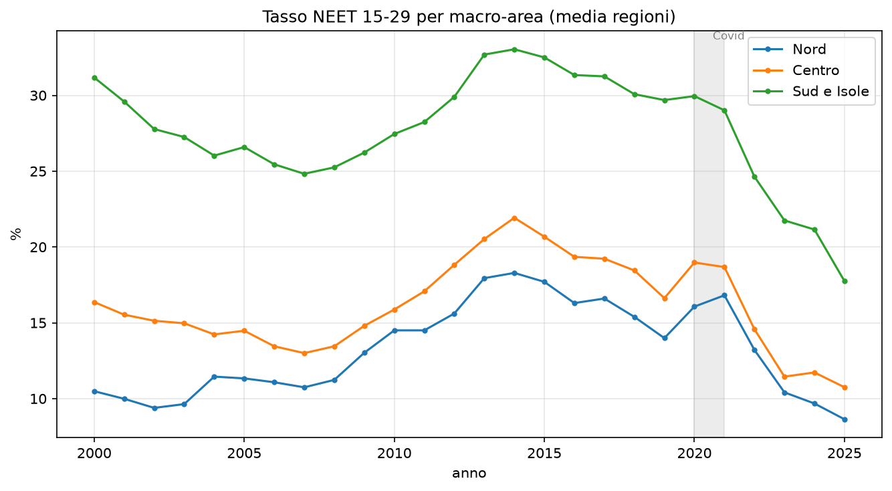

La media nazionale ha seguito una curva a gobba. È salita fino al 24,6% nel
2014, è scesa al 20,5% nel 2019, ha avuto un rimbalzo nel 2020 e nel 2021
per effetto della pandemia, ed è poi calata fino al 14,4% nel 2024. Il calo
degli ultimi anni è consistente e riguarda tutto il Paese.

Le tre ripartizioni, però, si sono mosse quasi in parallelo, mantenendo le
distanze. Il Sud è rimasto costantemente oltre i dieci punti sopra il Nord,
come se il divario avesse un livello minimo che non scende.

| Anno | Nord  | Centro | Sud e Isole |
|------|-------|--------|-------------|
| 2004 | 11,4% | 14,2%  | 26,0%       |
| 2014 | 18,3% | 21,9%  | 33,0%       |
| 2019 | 14,0% | 16,6%  | 29,7%       |
| 2024 | 9,7%  | 11,7%  | 21,2%       |

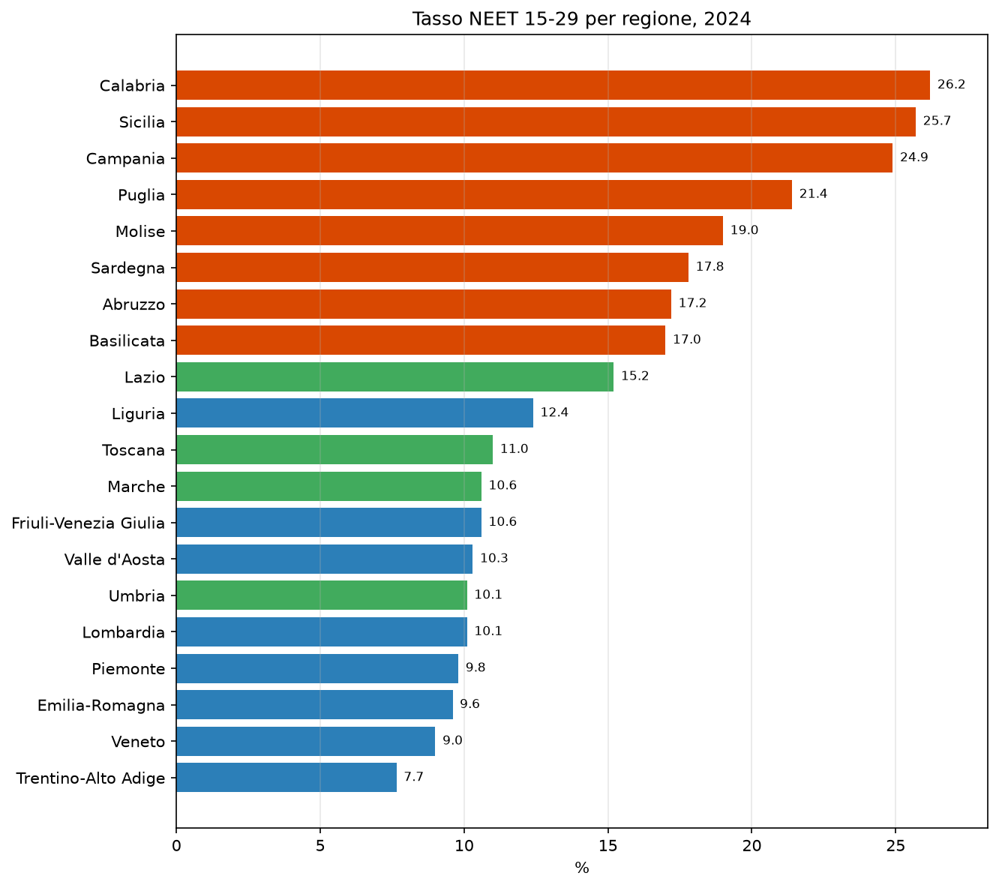

La classifica regionale del 2024 non lascia zone intermedie. In testa ci
sono Calabria (26,2%), Sicilia (25,7%), Campania (24,9%) e Puglia (21,4%).
In fondo troviamo Trentino-Alto Adige (7,7%), Veneto (9,0%) ed
Emilia-Romagna (9,6%). Nessuna regione settentrionale arriva al 12,5%;
nessuna meridionale scende sotto il 17%. Le due Italie, su questo
indicatore, non si toccano.

### 3.2 Titoli di studio e mercato del lavoro

Viene spontaneo attribuire il ritardo del Sud all'istruzione: pochi
laureati, molti giovani usciti presto dal sistema scolastico. I numeri
raccontano un'altra storia.

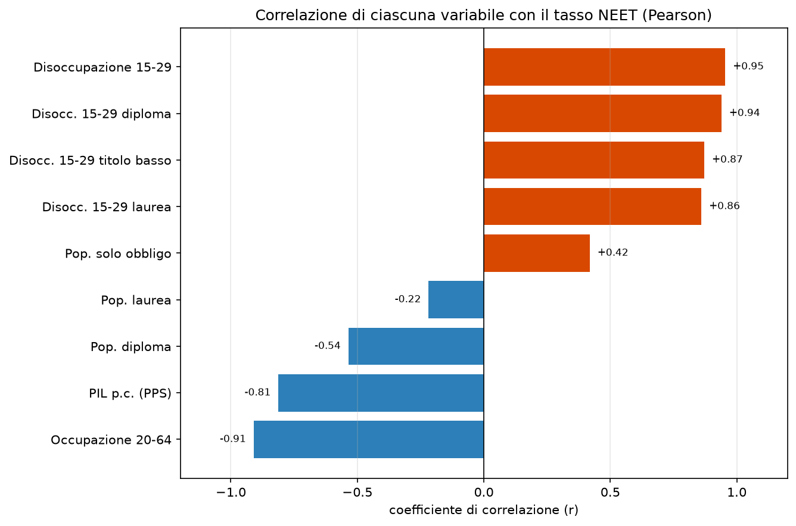

La quota di popolazione laureata ha un legame molto debole con il tasso di
NEET. Le variabili che invece procedono insieme al fenomeno sono quelle del
mercato del lavoro: la disoccupazione giovanile viaggia quasi in perfetta
sintonia con il NEET, l'occupazione in senso opposto, e anche il reddito pro
capite segue lo stesso andamento. In pratica, il livello di NEET di una
regione dipende soprattutto da quanto lavoro c'è, più che dal numero di
diplomi e lauree posseduti. È una conclusione scomoda, perché sposta
l'attenzione dalla scuola alle opportunità economiche del territorio.

### 3.3 Disoccupati e inattivi

NEET è un'etichetta che raccoglie situazioni diverse. Eurostat distingue chi
cerca attivamente lavoro da chi si è ritirato dalla ricerca, restando
inattivo.

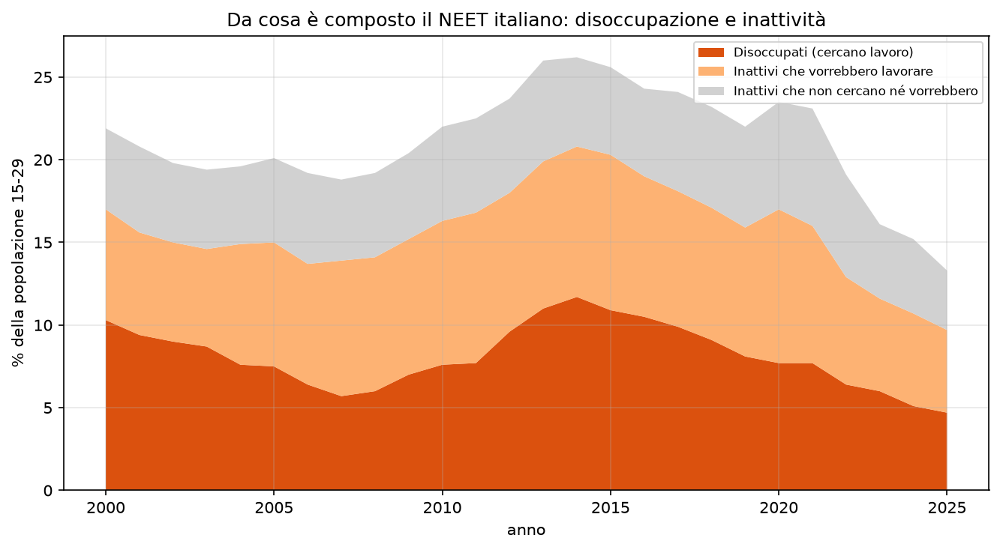

Nel 2024 la maggior parte dei NEET, circa sette su dieci, un lavoro lo
cercava o lo avrebbe voluto. Sono disoccupati oppure inattivi che, davanti a
un'occasione concreta, tornerebbero a cercare. La quota di chi dichiara di
non cercare né desiderare un impiego è minoritaria e si è ridotta rispetto
al 2019. Questa scomposizione invita a leggere il fenomeno con più cautela
di quanto faccia il discorso pubblico: la disponibilità a lavorare, tra i
giovani che risultano inattivi, c'è, e in misura larga.

### 3.4 Genere e partecipazione femminile

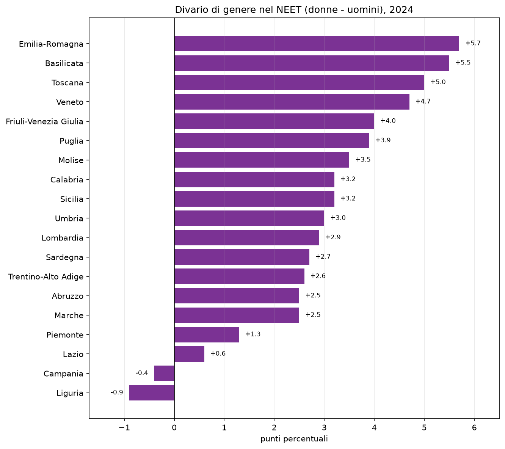

A livello nazionale il tasso di NEET delle donne supera quello degli uomini
di quasi tre punti. La differenza cambia però molto sul territorio. È ampia
in Emilia-Romagna, in Basilicata e in Toscana, dove sfiora o supera i cinque
punti, e diventa negativa in Campania e in Liguria, dove sono gli uomini a
essere più esposti. Nel Sud la disoccupazione maschile è così alta da
rendere il divario di genere, su questo indicatore, meno visibile.

Il dato che pesa di più, dal punto di vista strutturale, riguarda la
partecipazione delle donne al mercato del lavoro.

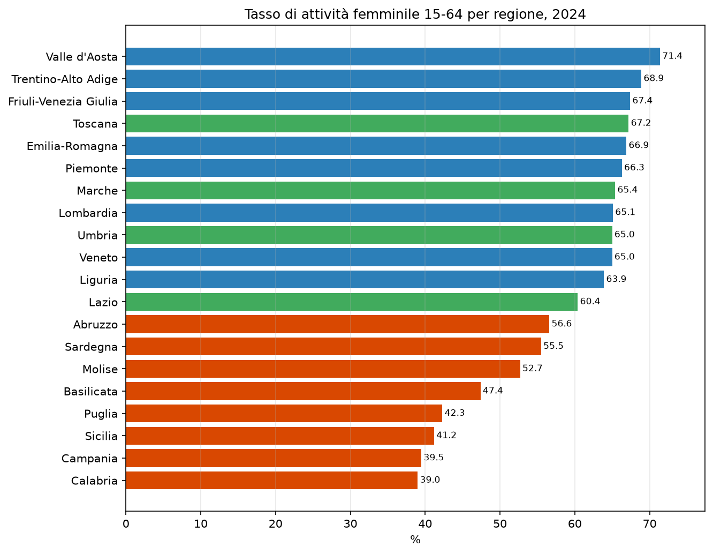

Il tasso di attività femminile va dal 39% della Calabria e dal 39,5% della
Campania al 71,4% della Valle d'Aosta. La distanza tra Nord e Sud supera i
venticinque punti ed è più ampia di quella misurata sui NEET.

### 3.5 Prevedere il rischio

Se si conoscono le condizioni economiche di una regione, se ne può prevedere
il tasso di NEET dell'anno successivo con ragionevole precisione. Un modello
statistico costruito su disoccupazione, occupazione, istruzione e reddito
spiega circa il 65% delle differenze tra regioni e anni, con un errore medio
di circa tre punti percentuali. Ripetere la media storica avrebbe prodotto
un errore di oltre sette punti.

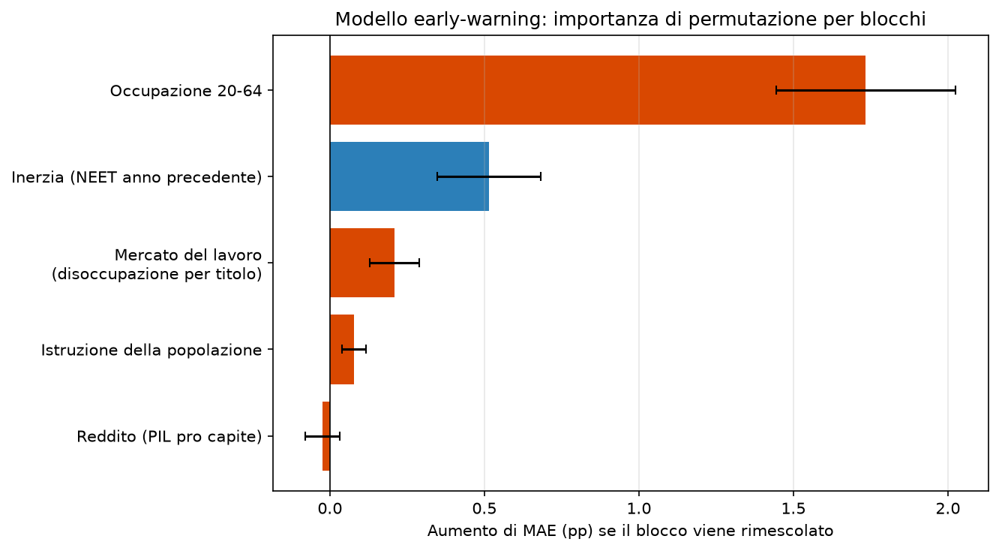

Il tasso di occupazione è la variabile più informativa. Una volta noto, le
altre aggiungono poco, perché l'informazione che portano è in buona parte
già contenuta in esso. Il modello, va detto, non contiene alcuna etichetta
di regione: il divario Nord-Sud compare da solo, come conseguenza di
occupazione, disoccupazione e reddito.

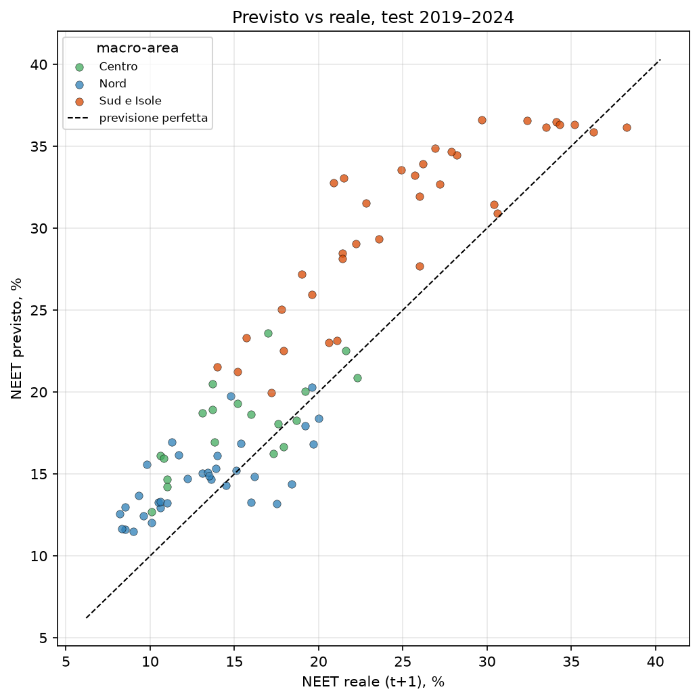

La verifica è stata fatta solo su anni successivi a quelli usati per
l'addestramento, dal 2019 al 2024, e mai su dati già visti. È la sola prova
onesta quando si vuole capire se un modello serve davvero a prevedere.

## 4. Le imprese e le competenze

### 4.1 Quanto è difficile trovare personale

Passiamo al lato delle imprese. Secondo Excelsior, delle 568.000 assunzioni
programmate per il trimestre luglio-settembre 2026, il 42,6% è giudicato di
difficile reperimento. La difficoltà cresce con la specializzazione
richiesta.

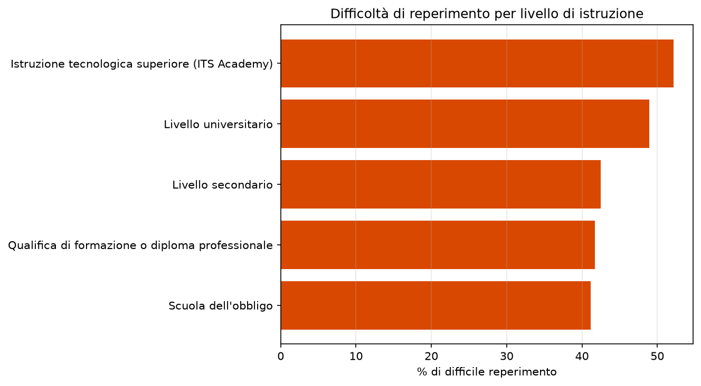

Le posizioni più numerose riguardano la ristorazione, il turismo e
l'amministrazione. Quelle più difficili da coprire sono invece tutte
tecniche: produzione e manutenzione industriale, con il 69% di difficile
reperimento, elettrico (63%), meccanico (61%), elettronica (60%) e ambito
sanitario (59%).

### 4.2 Cercasi candidati

Excelsior consente di distinguere due cause della difficoltà. Un'impresa può
non ricevere nessun candidato, oppure riceverne di non adeguatamente
preparati. La prima è una questione di quantità, la seconda di qualità, ed è
la seconda a costituire il disallineamento vero e proprio tra formazione e
lavoro.

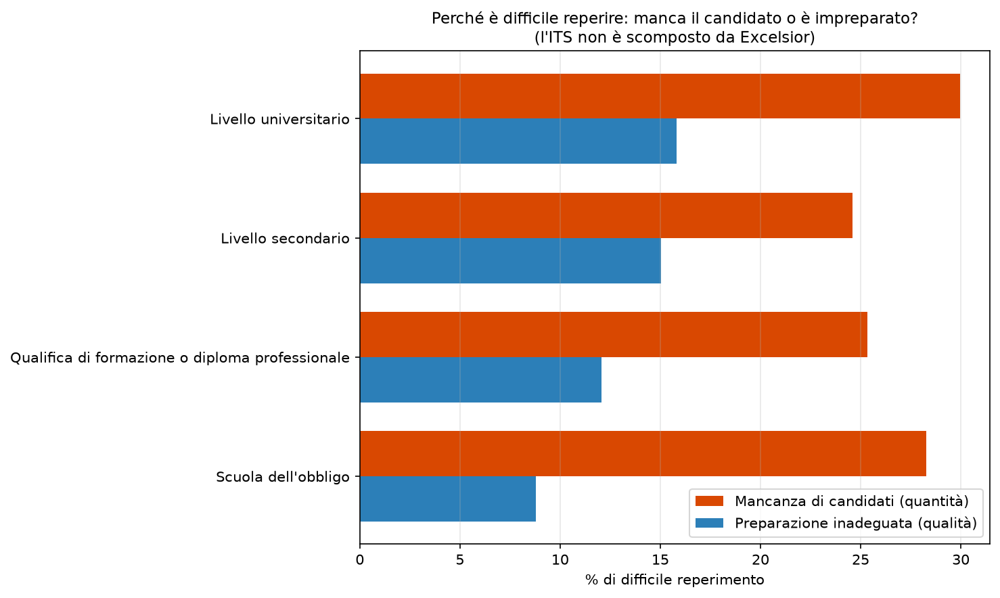

Le assunzioni difficili per mancanza di candidati sono il 26,2%, quelle
difficili per preparazione inadeguata il 12,6%. La prima causa vale circa il
doppio della seconda, e la prevalenza si ritrova a tutti i livelli di
istruzione. Il nodo, quindi, riguarda soprattutto il numero di persone
disponibili nei profili richiesti, prima ancora della loro preparazione.

### 4.3 Due geografie opposte

Mettendo a confronto le previsioni delle imprese con i tassi regionali di
NEET si arriva al risultato più interessante dell'analisi.

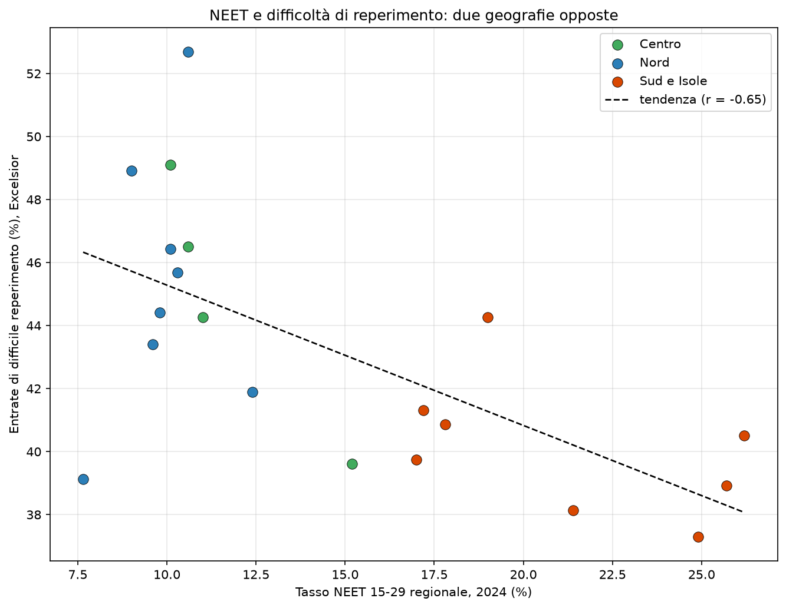

Dove il NEET è alto, cioè nel Sud, le imprese dichiarano meno difficoltà a
trovare personale. Dove il NEET è basso, al Centro-Nord, ne dichiarano di
più. La relazione è inversa e piuttosto marcata, e a sostenerla è
soprattutto la mancanza di candidati. La spiegazione sta nella natura
diversa dei due mercati del lavoro: al Sud la domanda è più debole e meno
qualificata, per cui tecnicamente mancano meno persone; al Nord la domanda è
sostenuta e a scarseggiare sono i profili tecnici.

## 5. Tre questioni diverse

Quello che chiamiamo il problema dei giovani e del lavoro in Italia è, a ben
guardare, la sovrapposizione di tre questioni con cause e rimedi differenti.

La prima è la debolezza della domanda di lavoro nel Sud. Qui i NEET sono
numerosi perché il lavoro è poco, e la chiave sta nella crescita e nelle
opportunità economiche.

La seconda è la bassa partecipazione femminile. In Calabria e in Campania
meno del 40% delle donne in età lavorativa è nel mercato del lavoro, e
questa assenza alimenta il bacino dei NEET.

La terza è la carenza di profili tecnici al Centro-Nord. In queste regioni i
NEET sono pochi, ma le imprese non trovano meccanici, elettricisti, tecnici
sanitari e diplomati degli ITS.

A tenere insieme le tre questioni è l'istruzione tecnico-professionale: al
Sud manca come sbocco occupazionale, al Nord come serbatoio di candidati.

## 6. Qualche indicazione

Nel Sud la priorità sembra stare nella creazione di lavoro e
nell'allargamento della partecipazione, soprattutto femminile, con
investimenti, politiche attive e servizi di cura. Al Centro-Nord la leva più
promettente è l'offerta formativa tecnica: rafforzare gli ITS, orientare
presto verso i mestieri tecnici, stringere legami stabili tra scuole e
imprese. In tutto il Paese servono poi politiche di incontro tra domanda e
offerta, dai servizi per l'impiego all'apprendistato, e un monitoraggio
continuo, basato su dati come questi, per capire se gli interventi
funzionano.

## 7. Limiti

Il tasso di NEET è una stima campionaria. È affidabile a livello regionale,
lo è meno per le regioni più piccole, e non va usato per conclusioni sulla
singola provincia.

Le previsioni di Excelsior misurano intenzioni dichiarate dalle imprese, non
assunzioni avvenute. Tendono a sovrastimare e non coprono l'intera economia;
la difficoltà di reperimento è una percezione delle aziende.

Il quadro sulle competenze si riferisce a un solo trimestre e serve a
descrivere una situazione, non a mostrare una tendenza. I dati provinciali
delle imprese seguono inoltre una ripartizione amministrativa storica, di
105 province, leggermente diversa da quella attuale.

Infine, le relazioni qui presentate sono associative. Che due fenomeni si
muovano insieme non dimostra che uno determini l'altro.

## Fonti

Eurostat, per il tasso di NEET regionale, la disoccupazione e l'occupazione
per titolo di studio, il tasso di attività e il prodotto pro capite
(<https://ec.europa.eu/eurostat>).

Sistema Informativo Excelsior, Unioncamere e Ministero del Lavoro e delle
Politiche Sociali, per le previsioni dei fabbisogni occupazionali delle
imprese (<https://excelsior.unioncamere.net>).
