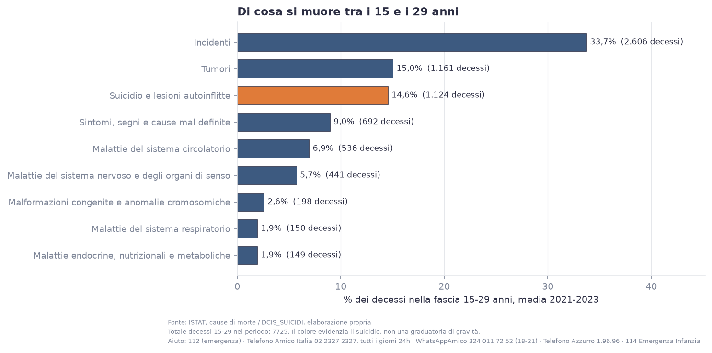
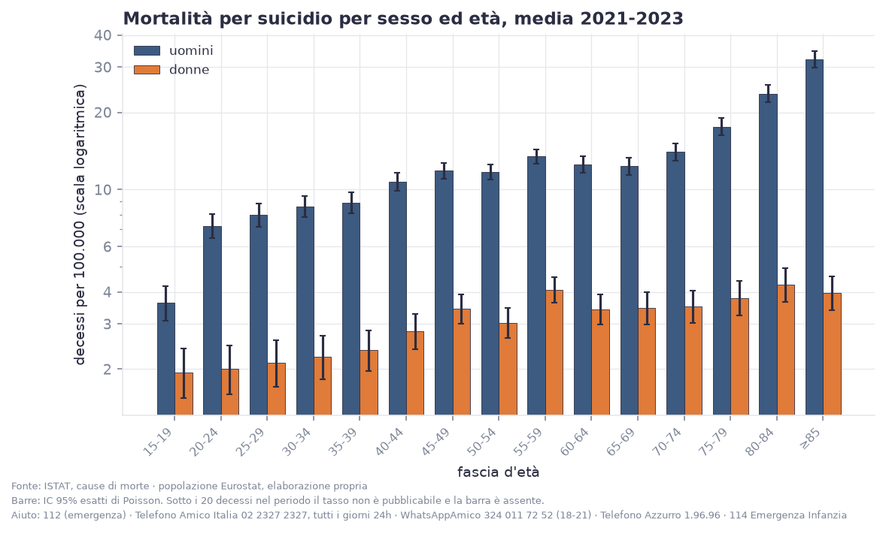
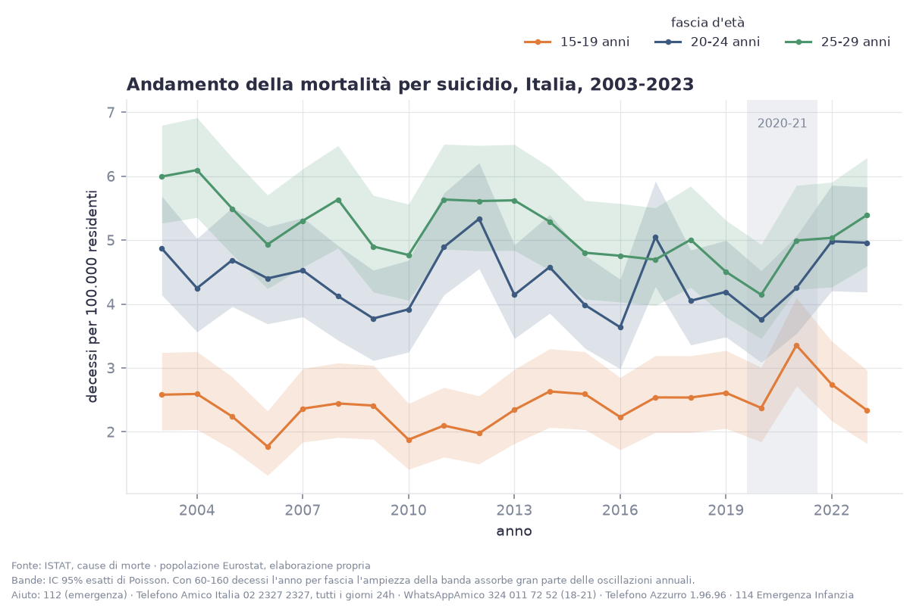
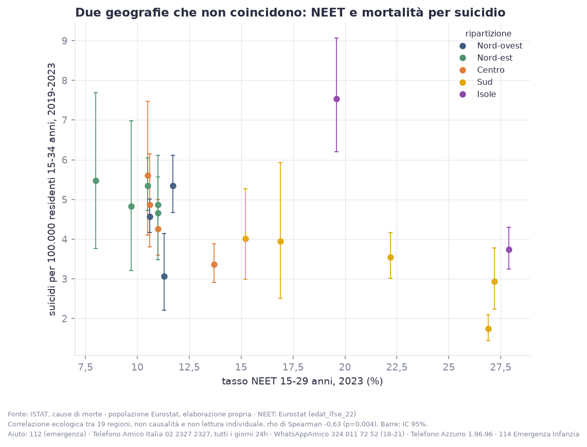
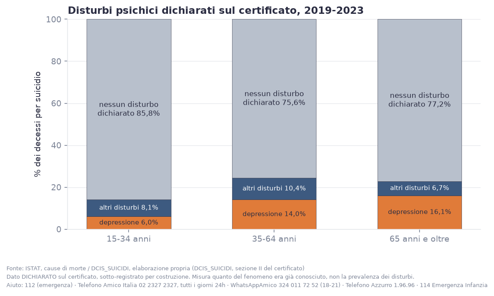
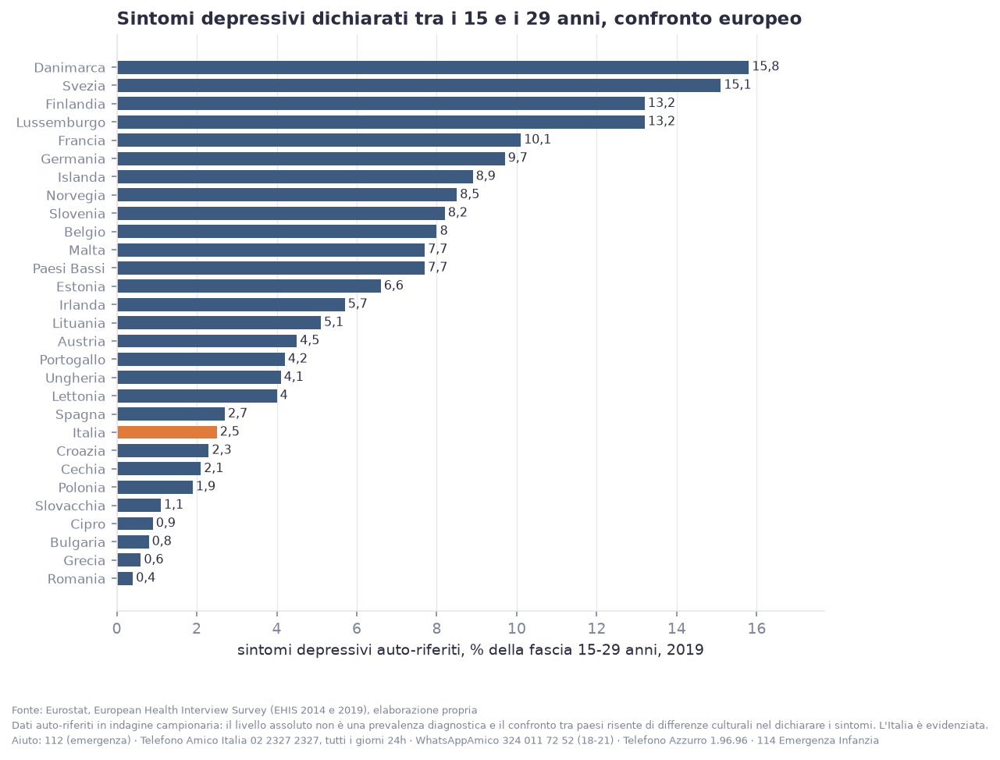
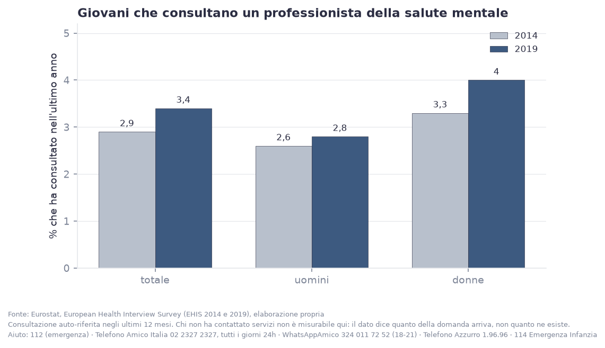
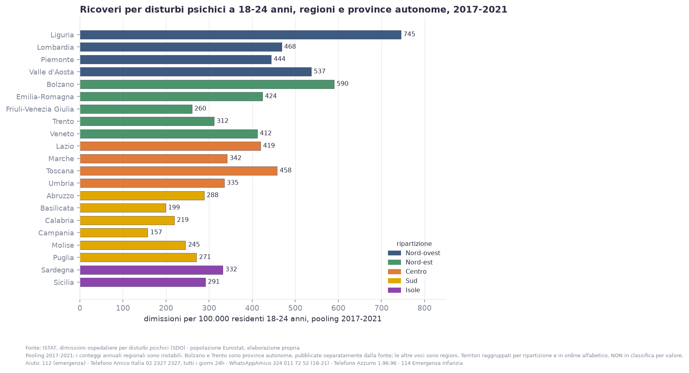
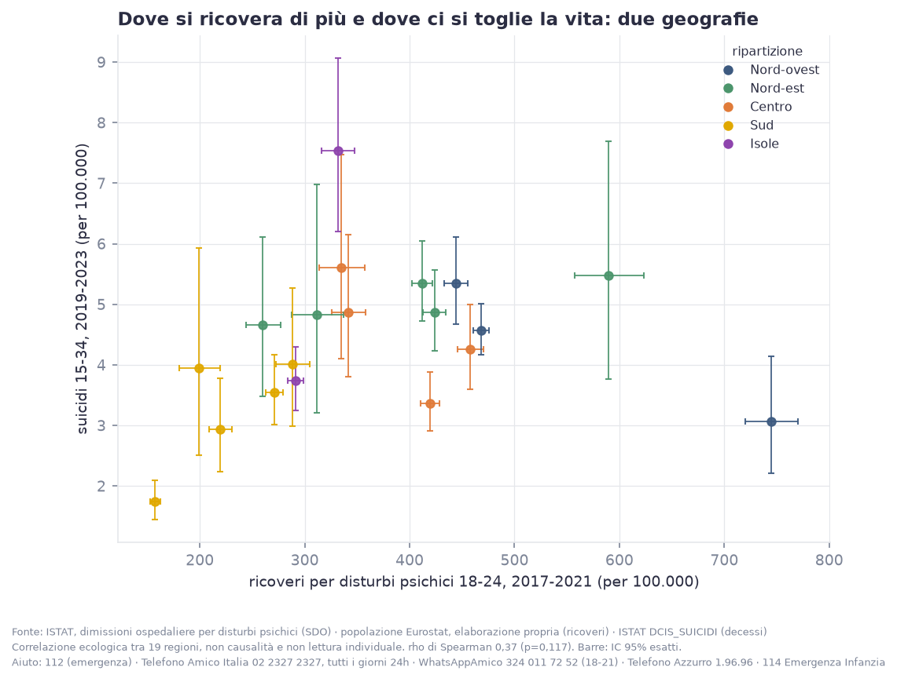

# Salute mentale e suicidio tra i giovani

## Premessa

Ogni anno, in Italia, muoiono per suicidio circa **358 persone tra i 15 e i
29 anni**. Sono i numeri ufficiali ISTAT, e sono il punto di partenza di
questo documento. Attorno a quei decessi c’è una salute mentale giovanile
che le statistiche ufficiali raccontano per pezzi: sintomi dichiarati,
contatti con i professionisti, ricoveri. Questa analisi mette i pezzi
accanto, senza sommarli. Una misura onesta è il modo più rispettoso di
parlare di questo tema.

## Il suicidio è la terza causa di morte tra i 15 e i 29 anni

Nel 2021-2023 il suicidio ha causato **1.124 decessi** nella fascia 15-29
anni: il **14,6%** di tutte le morti di questa età. Solo gli incidenti e i
tumori fanno di più. Se si tolgono gli incidenti, il suicidio è **la seconda
causa di morte** di una generazione.

Parliamo di una delle principali cause di morte per un ragazzo o una ragazza
di 15-29 anni in Italia.

## Muoiono soprattutto i ragazzi

Il tasso maschile è **6,3 per 100.000**, quello femminile **2,0**: un
rapporto di **3,1 a 1**. Il divario però non è costante: a 15-19 anni è di
1,9 a 1, a 25-29 sale a 3,8 a 1.

## Dopo il 2020 cambia il profilo delle ragazze

Sui vent’anni di dati disponibili (2003-2023) il trend generale della fascia
15-29 è leggermente in calo. Il test statistico su una rottura dopo il 2020,
sull’intera fascia, **non è significativo**. Ma il quadro si scompone: tra
le **donne** 15-29 il livello dopo il 2020 è aumentato in modo
statisticamente significativo (RR 1.23, p=0.021), tra gli uomini no; e nella
fascia 15-19 il trend di lungo periodo è in crescita (+0,9% l’anno).

Nessuno sta dicendo che la pandemia ha causato i suicidi. Il periodo va
letto separatamente per età e per sesso. I numeri delle ragazze sono più
piccoli e più incerti, e la media nazionale li nasconde: vanno guardati a
parte.

## Una geografia che sorprende

Il suicidio giovanile in Italia **non segue la geografia del disagio
economico**. Il tasso a 15-34 anni è più alto al Nord (1,5 volte quello del
Sud e delle Isole), e le estremità sono la **Sardegna** (7,5 per 100.000) e
la **Campania** (1,7). Confrontando regione per regione il tasso di suicidio
giovanile con il tasso di giovani che non studiano e non lavorano (NEET), la
correlazione è **negativa** (rho -0.63).

Le cause sono più d’una e non tutte economiche. La Sardegna, storicamente,
ha uno dei tassi di suicidio più alti d’Europa a tutte le età; la Campania
uno dei più bassi. Una spiegazione unica (disoccupazione, social, pandemia)
semplifica un fenomeno che i dati mostrano molteplice.

## Quanto del fenomeno attraversa i servizi di salute mentale

Nei certificati di morte, una quota dei decessi per suicidio riporta un
disturbo psichico già noto: **12,6% tra i 15 e i 34 anni**, di cui 6,0%
depressione. È una quota **sottostimata**, perché dipende da quanto il
medico certificatore registra, ed è più bassa tra i giovani che tra gli
anziani proprio perché le storie cliniche brevi si documentano meno.

Ma anche letta con prudenza dice una cosa concreta: una parte misurabile di
chi muore per suicidio era già in contatto con i servizi. È lì che la
prevenzione può arrivare prima.

## Il disagio che i giovani dichiarano

Dall'indagine europea sulla salute (EHIS), nel 2019 il **2,5% dei 15-29
anni** in Italia dichiara sintomi depressivi nelle ultime due settimane
(3,0% tra le donne, 2,0% tra gli uomini). Nel 2014 era l’1,8%. Non è una
diagnosi: è quello che le persone dicono di provare. Nel confronto europeo
l’Italia è tra i paesi con la quota più bassa, 9ª su 29 dal basso, ma il
confronto risente anche di differenze culturali nel raccontare i sintomi.

## Quanti arrivano ai professionisti

Nello stesso periodo, il **3,4% dei 15-29 anni** ha consultato uno
psicologo, uno psicoterapeuta o uno psichiatra negli ultimi 12 mesi: il 4,0%
tra le donne, il 2,8% tra gli uomini. Nel 2014 era il 2,9%. Il dato dice
quanta domanda arriva ai servizi, non quanta ne esiste: chi non li raggiunge
non compare.

## Dove si viene ricoverati per disturbi psichici

Le dimissioni ospedaliere per disturbi psichici nella fascia 18-24, la più
giovane disponibile, sono **391 per 100.000** nel 2021, in calo dal 2005
(416). Tra le regioni il divario è di oltre quattro volte: dalla Campania
(157) alla Liguria (745). Confrontando regione per regione i ricoveri con i
suicidi, il legame è debole e non si distingue dal caso (rho +0.37,
p=0.117): il ricovero dipende anche da come i servizi sono organizzati, non
solo dal bisogno.

## Il conteggio è più solido di quanto si creda, ma resta un minimo

Gli eventi classificati come “intento indeterminato”, la voce in cui
finiscono i suicidi non riconosciuti come tali, in Italia sono pochissimi:
lo **0,15%** dei suicidi a tutte le età. In altri paesi questa voce arriva a
quote a doppia cifra. Il conteggio ufficiale italiano è quindi relativamente
affidabile, e resta comunque un **valore minimo**.

## Nel confronto europeo l’Italia è tra i paesi con i tassi più bassi

Secondo le stime OMS, nel 2021 l’Italia è al **4° posto dal basso su 31**
paesi europei per tasso di suicidio a 15-29 anni: è nella parte **bassa**
della classifica. È il contesto corretto per leggere i numeri italiani, e
spiega perché copiare soluzioni da paesi con profili molto diversi funzioni
raramente.

## Cosa serve leggere accanto a questi numeri

Questi dati contano i decessi, i sintomi dichiarati e i contatti con i
servizi. Restano fuori i tentativi di suicidio e tutto il disagio che non
arriva a nessun servizio, ed è la parte più larga del fenomeno. Le due
fotografie europee del 2014 e del 2019 e la serie dei ricoveri ferma al 2021
dicono anche un’altra cosa: in Italia manca una sorveglianza continua del
malessere psicologico giovanile. Misurarlo meglio è il primo passo per
rispondere meglio.

**Se tu o qualcuno che conosci è in difficoltà, non restare solo/a:**

- **112**, numero unico di emergenza (o 118), in caso di pericolo immediato
- **Telefono Amico Italia, 02 2327 2327**, tutti i giorni 24 ore su 24
- **WhatsApp Amico, 324 011 72 52**, tutti i giorni 18-21
- **Mail Amica (mail@mica)**, counselling via email, su telefonoamico.it
- **Telefono Azzurro, 1.96.96** e **114 Emergenza Infanzia**, per bambini e
  adolescenti
- **Telefono Verde Alcol (ISS), 800 632 000**

In Italia non esiste un numero unico nazionale dedicato all’emergenza
suicidaria. È un’informazione sulle politiche di prevenzione, utile a chi
legge.
